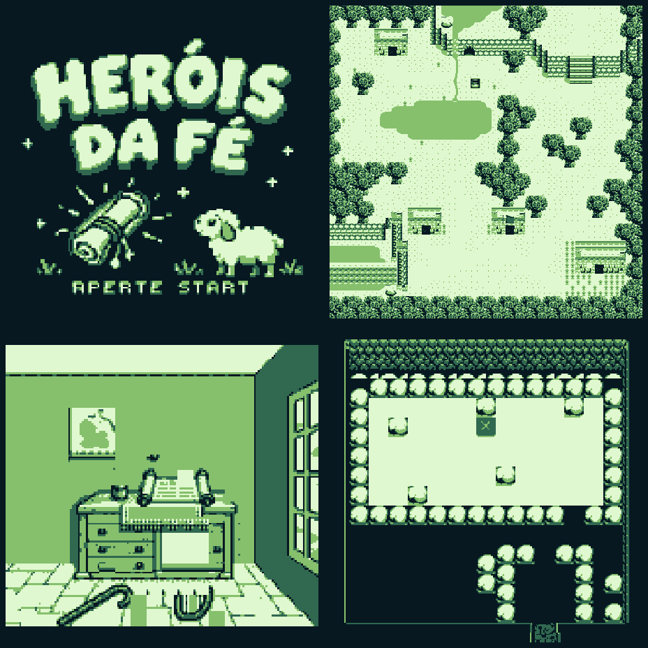

# HERÓIS DA FÉ

Demo de aventura bíblica para Game Boy, em português, baseada no modelo do GB Studio 4.2.0.

Abra **gospel/gospel.gbsproj** e escolha **Novo jogo**. Instruções em [LEIA-ME.md](LEIA-ME.md).

Inclui quatro fragmentos, diário, chefe com cinco impactos, final condicionado às quatro missões e arte temática integrada.

A arte passou na auditoria de dimensões, paleta, tiles e recortes. Os diálogos e a progressão passaram na verificação estrutural e simulação estática. **ROM e jogabilidade ainda precisam de teste no GB Studio.** Áudio do modelo preservado.

Veja o [pacote de arte](artes/LEIA-ME.md) e os [resultados de validação](docs/validacao_arte.txt).
