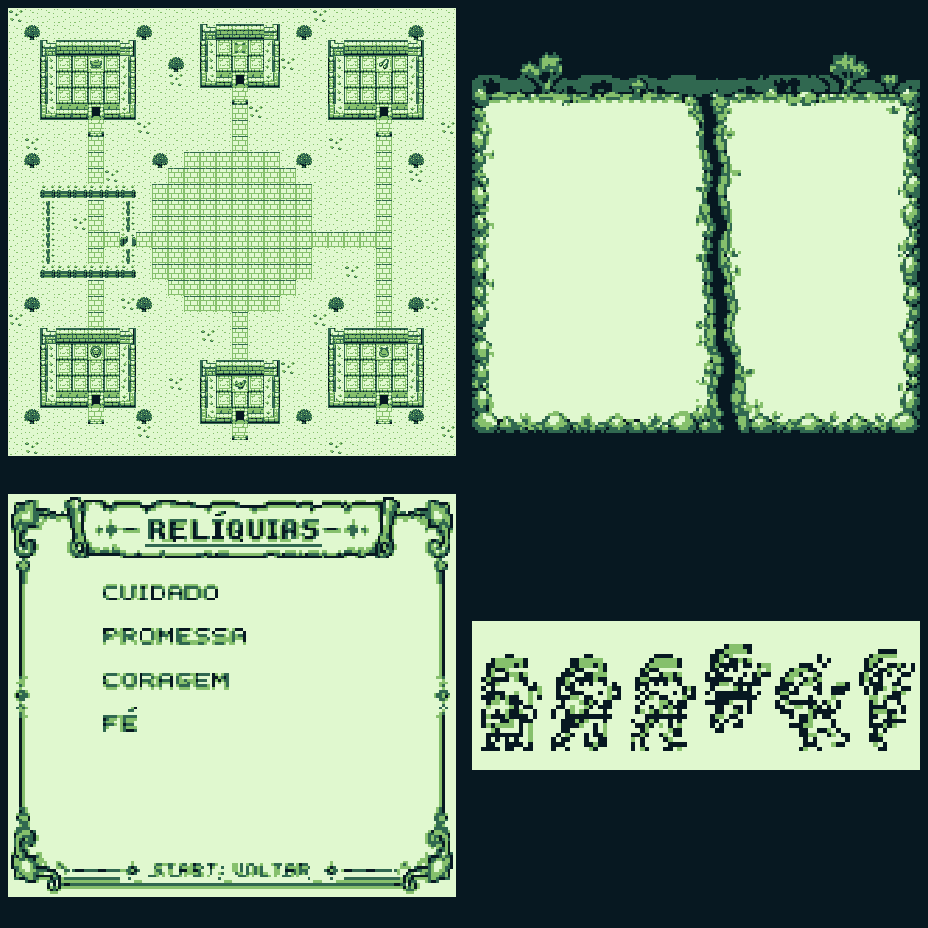

# HERÓIS DA FÉ — As quatro relíquias

Versão 2 da aventura bíblica em português para Game Boy, em GB Studio 4.2.0.

Abra **gospel/gospel.gbsproj** em uma pasta nova e escolha **Novo jogo**. Instruções em [LEIA-ME.md](LEIA-ME.md).

- Praça própria, com caminhos, seis entradas e quatro marcos de relíquias.
- Missão de Noé com resgate de três pares de animais.
- Golias em arena própria, com cinco pontos de resistência, ataques anunciados, três vidas, pausa e retry local.
- Diário com a próxima pista; progresso do bloco preservado.
- Cinco trilhas originais em UGE6 e arte preparada para os limites do Game Boy.

[Alterações e rota das relíquias](docs/versao2.md) · [Validação](docs/validacao_v2.txt)

Os testes são de arquivos e simulação de eventos. **A ROM e o áudio ainda precisam de conferência no GB Studio/emulador.** A base do projeto é o exemplo do GB Studio, preservado como referência; a versão atual altera mapa, missões, combate, animações e trilhas.
